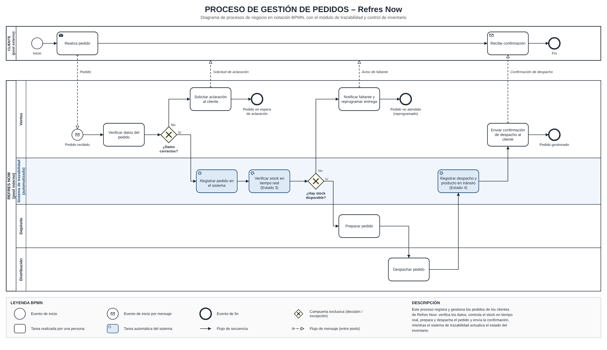
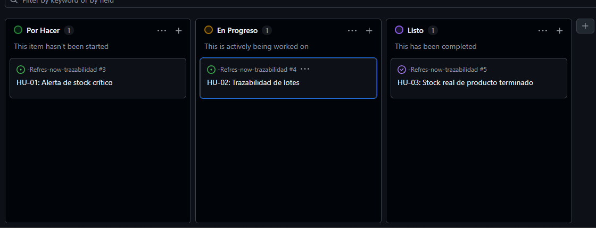

# -Refres-now-trazabilidad
# Sistema de Trazabilidad y Control de Inventario – Refres Now

## Descripción
Módulo de software que registra en tiempo real el recorrido de la materia
prima y del producto terminado, desde el ingreso a planta hasta la entrega
en los puntos de venta.

## Integrantes
- Luka Sfara – Tecnicatura Universitaria en Programación, UTN

## Documentación
- Diagrama BPMN del proceso de gestión de pedidos:

## Backlog Ágil
Tablero del proyecto: [Ver en GitHub Projects](https://github.com/users/Luka-Sfara/projects/4)

### Historias de Usuario
- **HU-01** (#3): Como encargado de compras, quiero recibir una alerta cuando el stock de un insumo baje del umbral crítico, para generar la orden de compra antes de que falte.
- **HU-02** (#4): Como responsable de calidad, quiero rastrear un lote desde la materia prima hasta el cliente que lo recibió, para avisar rápido a quién se entregó si hay que retirarlo.
- **HU-03** (#5): Como encargado de distribución, quiero ver el stock real de producto terminado en tiempo real, para organizar los envíos y evitar sobrestock o faltantes en los puntos de venta.
